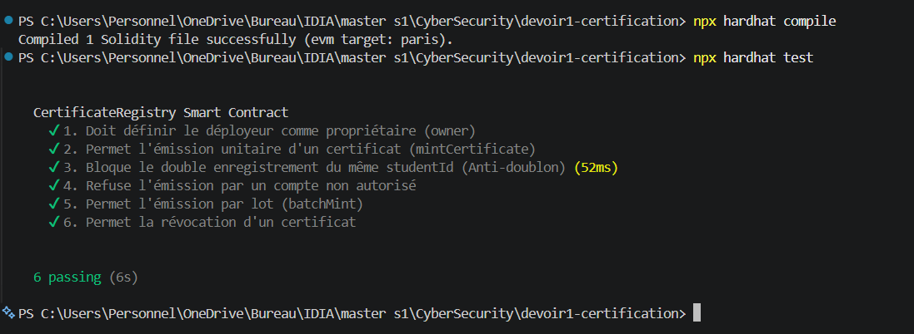
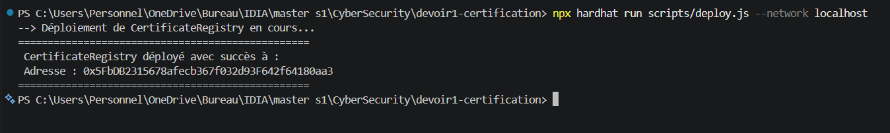
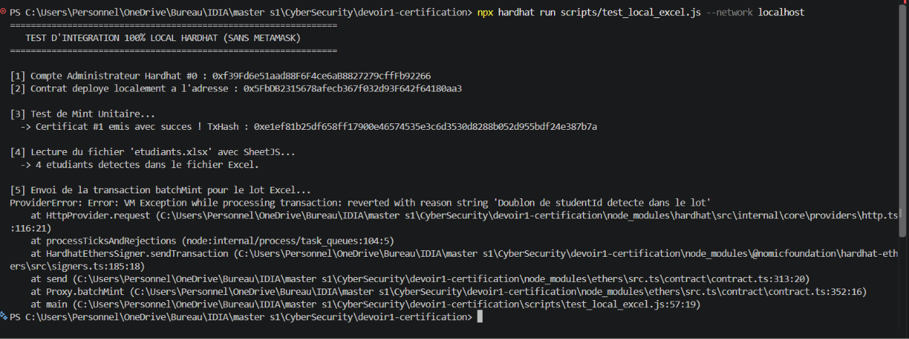
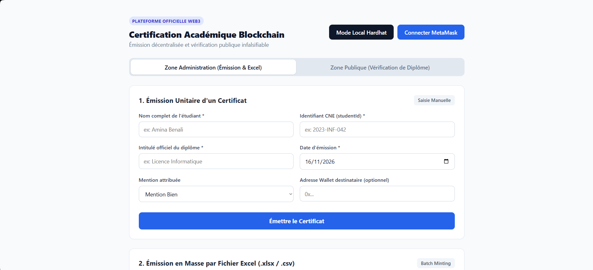
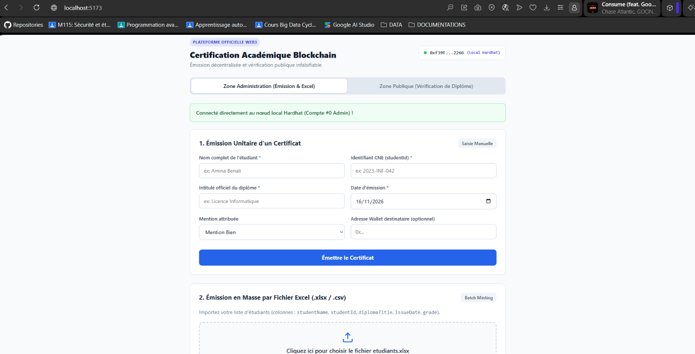
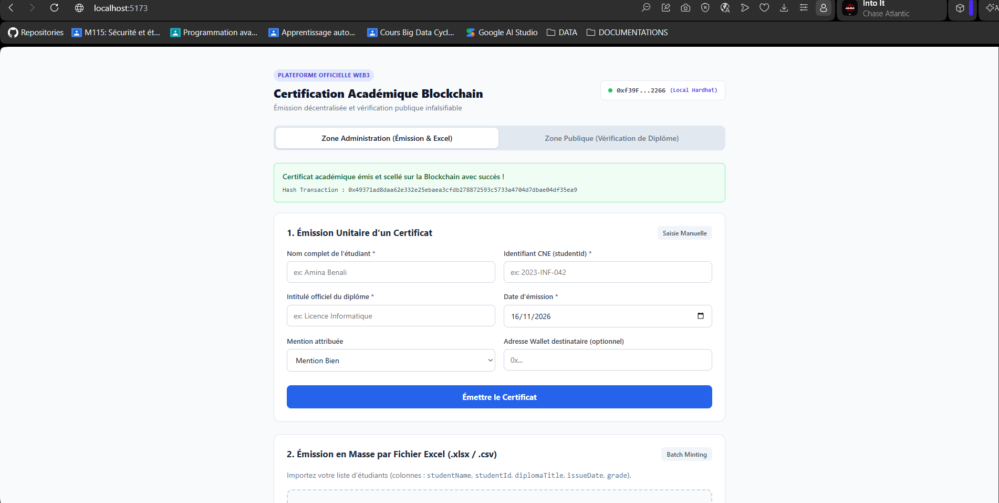
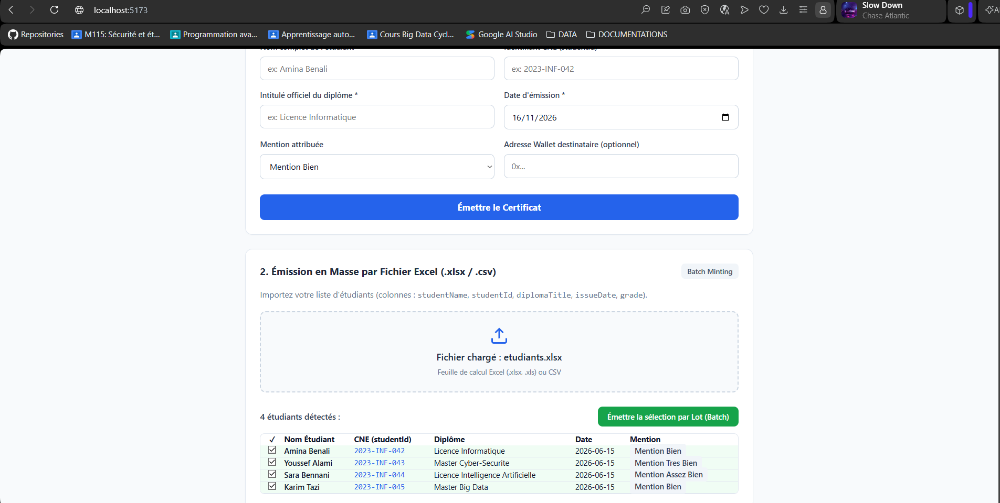
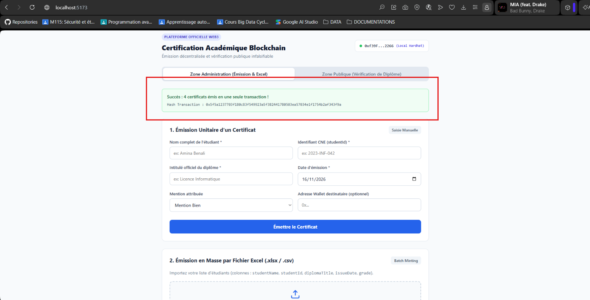
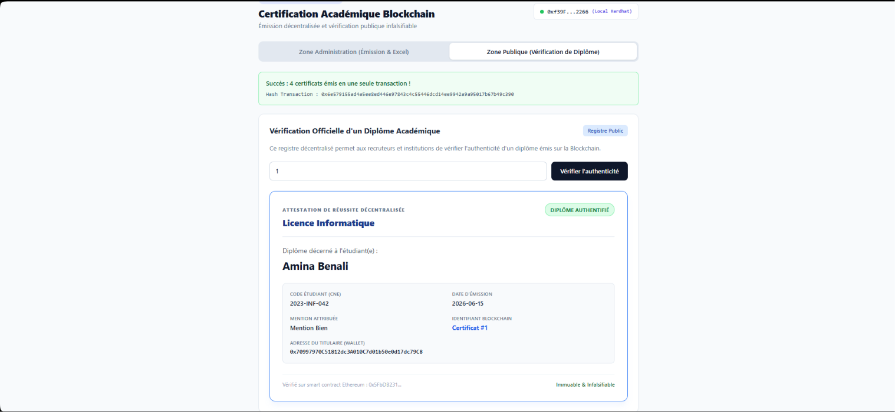

# 🎓 Système de Certification Académique sur Blockchain

**Université Abdelmalek Essaâdi**  
**Faculté des Sciences et Techniques – Tanger**  
**Master IDIA / Cybersécurité & Blockchain**  
**Année Universitaire :** 2026 / 2027  
**Enseignante :** Prof. Ikram BENABDELOUAHAB  
**Étudiant :** *Abajja Mohammed*  

---

## 📌 Présentation du Projet
Ce projet implémente un système complet de certification académique décentralisé (*Full-Stack Web3*) permettant à une université d'émettre des diplômes infalsifiables et vérifiables publiquement sur la blockchain Ethereum sans intermédiaire centralisé.

### Fonctionnalités Clés :
* **Smart Contract `CertificateRegistry` :** Stockage d'état immuable, contrôle d'accès administrateur (`onlyAuthorized`), règle de robustesse anti-doublon sur le CNE (`studentId`), émission par lot (`batchMint`) et fonction de révocation.
* **Zone Administration :** Connexion wallet, émission unitaire via formulaire et import en masse depuis un fichier Excel (`etudiants.xlsx`) analysé côté client via **SheetJS**.
* **Zone Publique :** Consultation instantanée et gratuite (`view`) par identifiant de certificat avec affichage officiel de l'attestation de réussite (Statut : *Authentifié* ou *Révoqué*).

---

## 🛠️ Stack Technique
* **Environnement Blockchain :** Hardhat (Nœud local & Sepolia Testnet)
* **Smart Contract :** Solidity `^0.8.26` (optimiseur Yul `viaIR: true`)
* **Frontend :** React 18 + Vite
* **Bibliothèque Web3 :** Ethers.js (v6)
* **Traitement Fichiers :** SheetJS (`xlsx`)

---

## 🚀 Installation & Lancement du Projet

### 1. Cloner le projet et installer les dépendances
```bash
# À la racine du projet (Hardhat)
npm install

# Dans le dossier frontend
cd frontend
npm install
cd ..
```

### 2. Lancer les tests unitaires automatisés
```bash
npx hardhat test
```

### 3. Démarrer la Blockchain locale et déployer
```bash
# Terminal 1 : Lancer le nœud local Hardhat
npx hardhat node

# Terminal 2 : Déployer le contrat
npx hardhat run scripts/deploy.js --network localhost
```
*Adresse du contrat déployé :* `0x5FbDB2315678afecb367f032d93F642f64180aa3`

### 4. Lancer l'application Web React
```bash
# Dans le dossier frontend
cd frontend
npm run dev
```
Accédez à l'application sur **`http://localhost:5173`**.

---

## 📸 Résultats d'Exécution & Preuves Expérimentales

### 1. Tests Unitaires Automatisés (Hardhat)
Validation des 6 exigences de robustesse (Access control, anti-doublon CNE, batch mint, révocation).


### 2. Déploiement Local du Contrat
Déploiement sur le réseau local Hardhat (Chain ID `31337`).


### 3. Script d'Intégration Directe (100% Local)
Exécution du script de test analysant `etudiants.xlsx` et validant le batch minting en ligne de commande.


### 4. Interface Web & Connexion Multi-Modes
Prise en charge du Mode Local direct Hardhat (Compte #0 Admin) et de l'extension MetaMask.



### 5. Émission Unitaire d'un Certificat
Saisie manuelle pour l'étudiante Amina Benali et validation de la transaction on-chain.


### 6. Importation de Fichier Excel & Émission par Lot
Chargement de `etudiants.xlsx`, parsing côté client avec SheetJS, sélection des lignes et exécution de `batchMint` en une seule transaction.



### 7. Vérification Publique & Consultation Décentralisée
Recherche publique par identifiant (`certId`) et génération de l'attestation officielle de réussite certifiée par la blockchain.


---

## 📁 Arborescence du Projet
```text
devoir1-certification/
├── contracts/
│   └── CertificateRegistry.sol     # Smart contract principal
├── scripts/
│   ├── deploy.js                   # Script de déploiement
│   └── test_local_excel.js         # Script d'intégration autonome
├── test/
│   └── CertificateRegistry.test.js # Suite de 6 tests automatisés
├── frontend/
│   ├── src/
│   │   ├── App.jsx                 # Interface utilisateur React
│   │   ├── contractConfig.js       # Configuration ABI & Adresse
│   │   └── index.css               # Feuilles de style
│   └── package.json
├── etudiants.xlsx                  # Fichier Excel de test
├── hardhat.config.js               # Configuration du compilateur et réseaux
└── README.md                       # Rapport technique
```